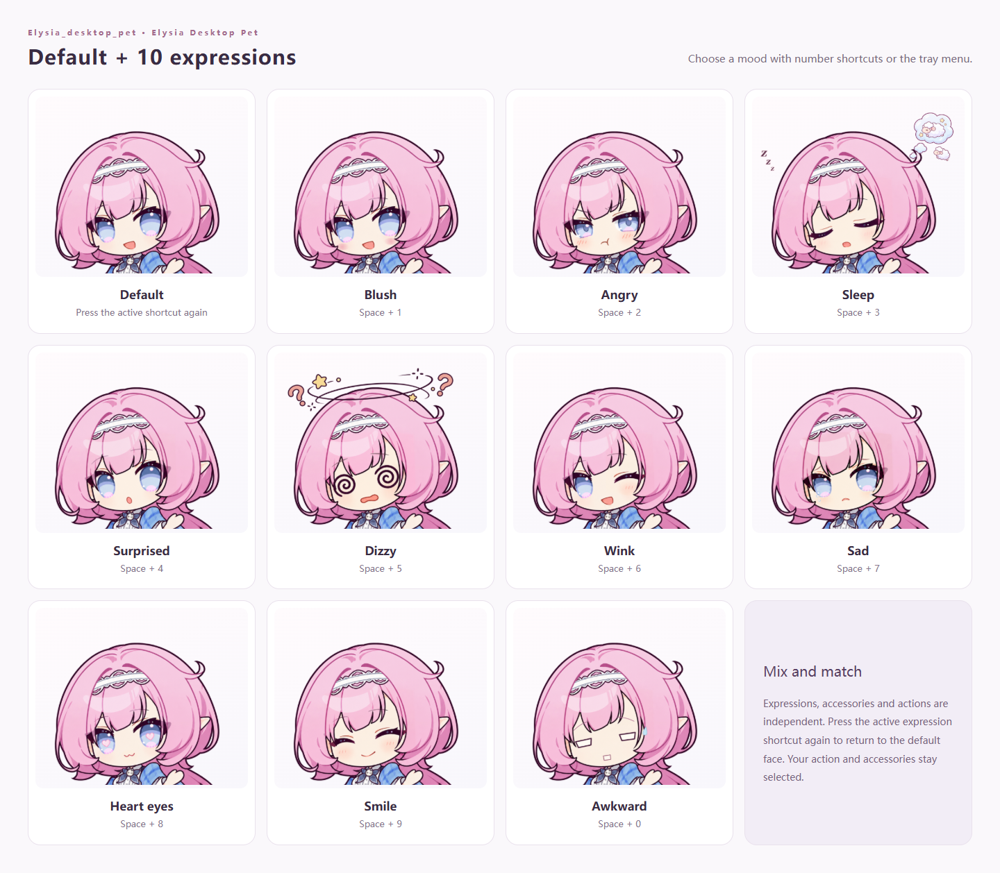
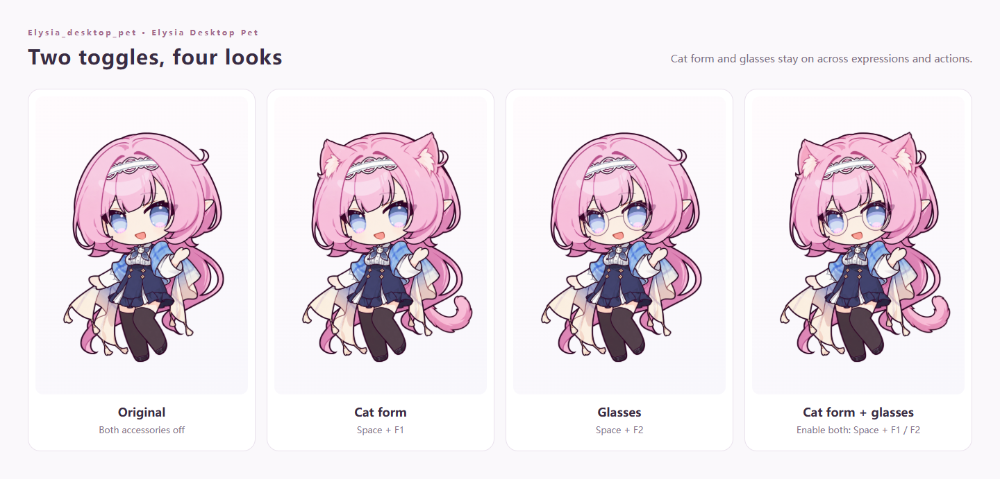
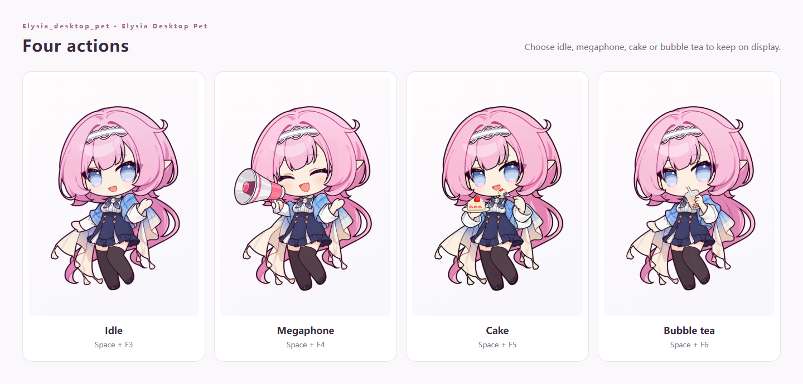

<h1 align="center">Elysia Desktop Pet</h1>

<p align="center">Elysia_desktop_pet · A little Elysia for your desktop</p>

<p align="center"><a href="README.md">简体中文</a> · <strong>English</strong></p>
<p align="center"><a href="#download">Download</a> · <a href="#character-gallery">Gallery</a> · <a href="#usage">Usage</a> · <a href="#run-from-source">Run from source</a></p>

A chibi Elysia companion for Windows, with a transparent full-body character, mouse-following eyes, and gentle motion. Mix expressions, cat mode, glasses, and four actions, with little clouds that respond to your typing.

## Download

**[Download for Windows · Portable 1.1.0](https://github.com/ActorF/Elysia_desktop_pet/releases/download/v1.1.0/Elysia_desktop_pet-1.1.0.exe)**

[Release notes](https://github.com/ActorF/Elysia_desktop_pet/releases/tag/v1.1.0) · [SHA256 checksum](https://github.com/ActorF/Elysia_desktop_pet/releases/download/v1.1.0/Elysia_desktop_pet-1.1.0.exe.sha256)

Download and double-click the EXE to run; no Node.js installation is needed. All settings are in Elysia's system tray menu, near the clock. To upgrade, quit the old version from that menu first. Your existing settings are kept.

<details>
<summary>Download warnings and files ending in .crdownload</summary>

The app is currently unsigned. If Microsoft Edge says the file “isn't commonly downloaded,” check that it came from this repository's release page. In the downloads list, choose **⋯ → Keep → Show more → Keep anyway**, then wait for the download to finish. See [Microsoft's instructions](https://learn.microsoft.com/en-us/troubleshoot/microsoft-edge/development/download-failures#check-security-and-smartscreen-settings).

**If the download has fully completed but the file is still named `Unconfirmed <number>.crdownload`, you can rename it to use the `.exe` extension.** Enable **File name extensions** in File Explorer, then change the complete filename to **`Elysia_desktop_pet-1.1.0.exe`**. Remove the trailing `.crdownload` entirely.

This only applies to a file that has finished downloading. If the download is still running or was interrupted, complete it first; renaming an incomplete file does not finish the download.

</details>

## Character gallery

### Full-body character

<p align="center">
  
</p>

<p align="center"><a href="docs/media/idle.webm">Watch the idle animation</a></p>

### Expressions

There are **11 facial states**: Neutral, Blush, Angry, Sleep, Surprised, Dizzy, Wink, Sad, Heart Eyes, Smile, and Awkward.



### Forms

Cat mode and glasses are independent switches. Use the original appearance, cat mode, glasses, or both together. Your choices stay active when you change expressions or actions, and after restarting the app.



### Actions

Choose one of four actions: **Idle, Megaphone, Cake, or Bubble tea**. Changing an expression or outfit keeps the current action. The megaphone does not play sound.



### Key clouds

**New in 1.1.0.** A pale pink-and-white cloud shows a single character above her hand during Idle, Cake, and Bubble tea. With Megaphone selected, it floats outward from the horn with illustrated sound waves, fading within about a second.


<p align="center"><a href="docs/media/megaphone-key-cloud.webm">Watch the megaphone key effect</a> · Visual effect only, no sound</p>

## Usage

### Mouse and system tray

| Control | What it does |
| --- | --- |
| Hold the left mouse button on the character and drag | Move her freely, including partly beyond any edge of the screen |
| Hold the right mouse button on the character and scroll | Scroll up to enlarge or down to shrink; starts at 1% with no fixed upper size limit |
| Click or right-click the system tray icon | Select expressions, outfits, actions, and settings |
| Choose “Show / Restore interaction” (`显示 / 恢复操作`) or press `Ctrl + Alt + P` | Bring her back into view and turn off click-through |
| Choose “Restore 100% size and bring back” (`恢复 100% 大小并找回桌宠`) | Reset the size and bring her back onto the screen |
| Choose “Quit desktop pet” (`退出桌宠`) | Close the app |

Transparent space around the character lets clicks pass through to the windows behind her. Scrolling alone does not resize her, and hovering over or right-clicking the character does not open a settings panel.

The tray menu also controls eye tracking; hair, clothing, and leg motion; always-on-top behavior; click-through for the entire character; and both sets of global shortcuts. Position, size, and preferences are saved automatically.

### Key cloud behavior

A rounded, pale pink-and-white cloud displays **only the most recently pressed character**. It supports `0–9`, `a–z`, `A–Z`, and English punctuation and symbols. A space is shown as `␣`. Shift and Caps Lock determine letter case; Shift also selects the corresponding symbols.

Enter, Ctrl, Tab, arrow keys, and other control keys are not displayed. Shortcuts using Ctrl, Alt, or the Windows key are also excluded. Each new character replaces the previous one, and the cloud disappears within about one second of the latest input.

During Idle, Cake, and Bubble tea, the cloud briefly stays above her raised hand before fading out. During Megaphone, it moves outward to the upper left from the horn and fades throughout that second, accompanied by drawn sound-wave arcs. This is a visual effect only, with no sound.

Use **Key cloud** (`按键云朵`) in the tray menu to turn it on or off. It does not change the existing expression shortcuts. Input is used only for the immediate display; no typed text or key history is recorded or saved.

### Expression shortcuts

Hold **Space**, then press a number on either the number row or the numeric keypad. Triggering the same expression again restores the neutral face, while keeping the current action and outfit.

| Shortcut | Expression | Shortcut | Expression |
| --- | --- | --- | --- |
| Space + 1 | Blush | Space + 2 | Angry |
| Space + 3 | Sleep | Space + 4 | Surprised |
| Space + 5 | Dizzy | Space + 6 | Wink |
| Space + 7 | Sad | Space + 8 | Heart Eyes |
| Space + 9 | Smile | Space + 0 | Awkward |

### Outfit and action shortcuts

| Shortcut | Feature | Behavior |
| --- | --- | --- |
| Space + F1 | Cat mode | Toggle independently |
| Space + F2 | Glasses | Toggle independently |
| Space + F3 | Idle | Select this action |
| Space + F4 | Megaphone | Select this action |
| Space + F5 | Cake | Select this action |
| Space + F6 | Bubble tea | Select this action |
| Space + Backspace | Reset appearance | Restore the neutral face and Idle action; turn off cat mode and glasses |

Space shortcuts work while other windows are active and do not block those apps from receiving your keystrokes. You can disable them in the tray menu, or enable the alternative **Ctrl + Alt + number / F key / Backspace** shortcuts. Every feature is also available from the tray menu.

## Run from source

Requires **Windows and Node.js 22 or later**. Browser-based visual checks also require Microsoft Edge.

```powershell
git clone https://github.com/ActorF/Elysia_desktop_pet.git
cd Elysia_desktop_pet
npm ci
npm start
```

Run checks and build the portable app:

```powershell
npm test
npm run test:smoke
npm run test:visual
npm run test:faces
npm run test:zoom
npm run make:portable
node scripts/verify-package.cjs
```

The portable executable is generated in `release/`. Use `npm run package` to build an unpacked application directory. `npm run preview:expressions` generates expression previews, and `npm run preview:motion` records an idle animation. Run `node scripts/gallery-preview.cjs --language=en` for the English galleries, or `node scripts/key-cloud-preview.cjs` for the key-cloud gallery. See the [verification guide](docs/verification.md) for additional checks; the guide is currently in Chinese.

## Project structure

| Path | Contents |
| --- | --- |
| `electron/` | Transparent window, system tray, global shortcuts, key display input, dragging, resizing, and saved settings |
| `renderer/` | Character drawing, expressions and actions, eye tracking, motion, and key cloud effects |
| `assets/character/` | Character artwork required by the app |
| `scripts/` | Launch, package verification, and preview tools |
| `tests/` | Automated tests |
| `docs/` | Character previews, release notes, and verification documentation |
| `release/` | Locally generated Windows portable app |
| `LICENSE` | MIT license for the code |

The app uses an Electron transparent window, composited PNG artwork, and WebGL mesh animation. When WebGL is unavailable, it displays the statically composited character.

## License & credits

The project code is released under the [MIT License](LICENSE). Elysia, *Honkai Impact 3rd*, and their related characters and brands belong to miHoYo / HoYoverse and their respective rights holders. The CoCo Fresh Tea & Juice brand belongs to its respective rights holders.

This is an unofficial fan project. The MIT license for the code does not grant rights to these characters or brands. See the [asset notice](ASSET-NOTICE.md).
