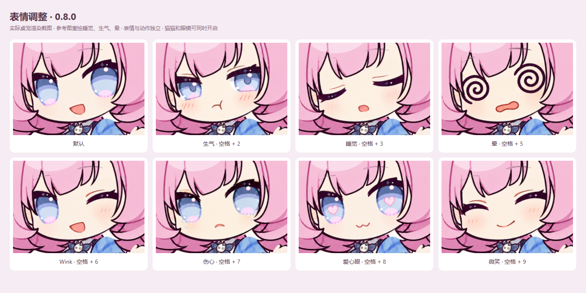
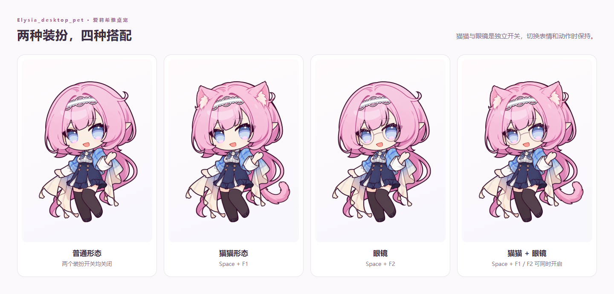
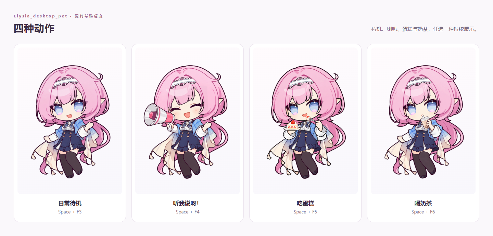
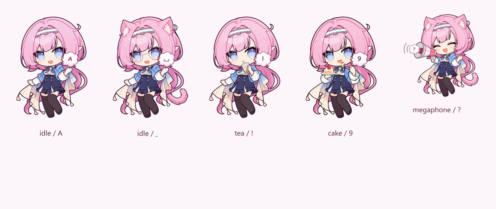

# 爱莉希雅桌宠 / Elysia_desktop_pet

爱莉希雅 Q 版 Windows 桌宠。透明全身立绘、鼠标目光跟随、轻柔摆动，搭配可自由组合的表情、装扮与动作。

## 下载程序

**1.1.0 · Windows 便携版（待发布）**

1.1.0 程序已在本地打包，尚未发布 GitHub Release，以下 1.1.0 下载链接会在正式发布后生效。现在可从 [1.0.0 发布页面](https://github.com/ActorF/Elysia_desktop_pet/releases/tag/v1.0.0) 下载已发布版本。

- [下载 Windows 便携版 1.1.0](https://github.com/ActorF/Elysia_desktop_pet/releases/download/v1.1.0/Elysia_desktop_pet-1.1.0.exe)：双击运行，无需安装 Node.js。
- [查看 1.1.0 发布页面](https://github.com/ActorF/Elysia_desktop_pet/releases/tag/v1.1.0) · [SHA256 校验文件](https://github.com/ActorF/Elysia_desktop_pet/releases/download/v1.1.0/Elysia_desktop_pet-1.1.0.exe.sha256)

**下载提示：** 当前版本未进行数字签名。如果 Edge 提示“isn't commonly downloaded（不常下载）”，确认文件来自本仓库发布页后，在下载列表选择 **⋯ → 保留 → 显示更多 → 仍然保留**，等待下载完成。[微软操作说明](https://learn.microsoft.com/en-us/troubleshoot/microsoft-edge/development/download-failures#check-security-and-smartscreen-settings)

**下载完成后，如果文件仍叫 `Unconfirmed 数字.crdownload`，可以将后缀改为 `.exe` 使用。** 先在文件资源管理器中显示“文件扩展名”，再将完整文件名改为 **`Elysia_desktop_pet-1.1.0.exe`**，不要保留末尾的 `.crdownload`。此操作只适用于已经完整下载的文件；仍在下载或下载中断时，请先完成下载。

程序运行后，所有设置都在右下角系统托盘的爱莉希雅图标中。若已有桌宠运行，请先从其托盘菜单退出。

## 角色展示

### 全身立绘


[观看待机动画](docs/media/idle.webm)

### 全部表情

默认表情，以及害羞、生气、睡觉、惊讶、晕、Wink、伤心、爱心眼、微笑、囧，共 **11 种脸部状态**。



### 不同形态

猫猫形态与眼镜是两个独立开关，可以组合成原始形态、猫猫、眼镜、猫猫＋眼镜。装扮在切换表情、动作和重新启动后保留。



### 动作与手势切换

日常待机、听我说呀！、吃蛋糕、喝奶茶四选一。切换表情或装扮时，当前动作保持不变。喇叭动作不播放声音。



## 使用

### 鼠标与托盘

| 操作 | 功能 |
| --- | --- |
| 按住人物并用鼠标左键拖动 | 移动桌宠，可拖出屏幕四边 |
| 按住人物上的鼠标右键＋滚轮 | 向上放大、向下缩小，从 1% 起持续放大 |
| 点击或右键右下角托盘图标 | 选择全部表情、装扮、动作和设置 |
| 托盘“显示 / 恢复操作”或 `Ctrl + Alt + P` | 找回人物并关闭点击穿透 |
| 托盘“恢复 100% 大小并找回桌宠” | 重置大小并将人物带回屏幕 |
| 托盘“退出桌宠” | 退出程序 |

人物外的透明区域自动穿透，不妨碍操作后方窗口。普通滚轮不会缩放，鼠标经过或右键人物不会弹出设置面板。

托盘还可以开关目光跟随、头发与衣摆和腿部摆动、始终置顶、整个人物点击穿透，以及两种全局快捷键。位置、大小和偏好会自动保存。

### 按键云朵

抬起的手心正上方会显示一朵圆润的浅粉白色云朵，每次只显示最近按下的一个字符。支持 `0–9`、`a–z`、`A–Z`、英文标点与符号；空格显示为 `␣`。Shift 和 Caps Lock 决定字母大小写，Shift 也会切换对应符号。

Enter、Ctrl、Tab、方向键等功能键不显示，Ctrl／Alt／Win 快捷组合也不显示。连续输入直接替换前一个字符，最后一次输入后约 1 秒内消失。待机、吃蛋糕和喝奶茶时，云朵在手上方短暂停留后淡出；喇叭动作时，字符从喇叭口朝左上方飘出，并在 1 秒内逐渐淡出，附带手绘扩音弧线（仅图像效果）。可从托盘开关“按键云朵”，不影响原来的表情快捷键。按键仅用于即时显示，不记录或保存输入内容。



[观看喇叭按键特效](docs/media/megaphone-key-cloud.webm)

### 表情快捷键

按住 **空格**，再按下对应数字；数字行和数字小键盘均可使用。再次触发同一表情恢复默认脸，动作与装扮不变。

| 组合键 | 表情 | 组合键 | 表情 |
| --- | --- | --- | --- |
| 空格＋1 | 害羞 | 空格＋2 | 生气 |
| 空格＋3 | 睡觉 | 空格＋4 | 惊讶 |
| 空格＋5 | 晕 | 空格＋6 | Wink |
| 空格＋7 | 伤心 | 空格＋8 | 爱心眼 |
| 空格＋9 | 微笑 | 空格＋0 | 囧 |

### 装扮与动作快捷键

| 组合键 | 功能 | 切换方式 |
| --- | --- | --- |
| 空格＋F1 | 猫猫形态 | 独立开关 |
| 空格＋F2 | 眼镜 | 独立开关 |
| 空格＋F3 | 日常待机 | 选择动作 |
| 空格＋F4 | 听我说呀！ | 选择动作 |
| 空格＋F5 | 吃蛋糕 | 选择动作 |
| 空格＋F6 | 喝奶茶 | 选择动作 |
| 空格＋Backspace | 全部重置 | 默认脸、日常待机、关闭猫猫与眼镜 |

空格组合键在其他窗口中也可用，并且不会拦截其他软件的按键输入。可在托盘关闭空格组合键，或开启备用的 **Ctrl＋Alt＋对应数字／F 键／Backspace**。全部功能也能直接从托盘菜单选择。

## 源码运行

需要 **Windows、Node.js 22 或更新版本**。浏览器视觉检查还需要 Microsoft Edge。

```powershell
git clone https://github.com/ActorF/Elysia_desktop_pet.git
cd Elysia_desktop_pet
npm ci
npm start
```

测试与打包：

```powershell
npm test
npm run test:smoke
npm run test:visual
npm run test:faces
npm run test:zoom
npm run make:portable
node scripts/verify-package.cjs
```

便携版生成在 `release/`。`npm run package` 可生成未封装的应用目录；`npm run preview:expressions` 和 `npm run preview:motion` 可生成表情截图与待机录像。更多检查见[验证说明](docs/verification.md)。

## 项目结构

| 目录或文件 | 内容 |
| --- | --- |
| `electron/` | 透明窗口、托盘、全局快捷键、拖动、缩放与设置保存 |
| `renderer/` | 人物绘制、表情与动作组合、目光跟随和摆动 |
| `assets/character/` | 桌宠运行所需的角色素材 |
| `scripts/` | 启动、构建验证与预览工具 |
| `tests/` | 自动测试 |
| `docs/` | 角色预览与验证说明 |
| `release/` | 本地生成的 Windows 便携版 |
| `LICENSE` | MIT 代码许可证 |

项目使用 Electron 透明窗口、PNG 素材合成与 WebGL 网格动画。WebGL 不可用时显示静态合成角色。

## 授权与版权

项目代码使用 [MIT License](LICENSE)。爱莉希雅、《崩坏3》相关角色与品牌权利归 miHoYo / HoYoverse 及其权利人所有，CoCo 都可品牌权利归其权利人所有。本项目为非官方作品；MIT 代码许可不授予这些角色与品牌的权利。见[版权说明](ASSET-NOTICE.md)。
