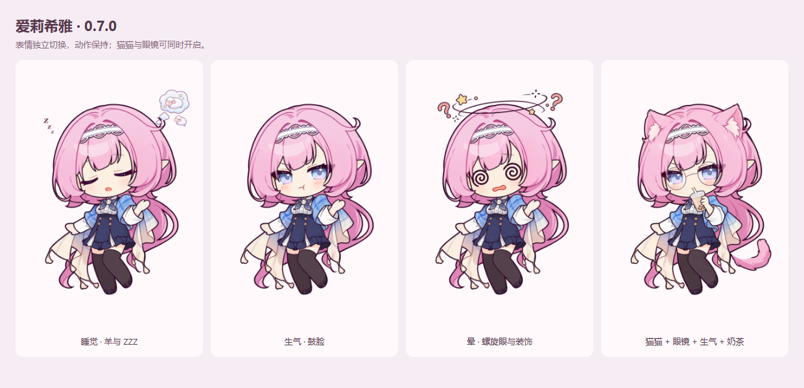

# Elysia Standalone Pet

独立运行的 Windows 爱莉希雅 Q 版桌宠：透明窗口、全身人物、没有键盘，也不依赖 BongoCat 或 Elysia AI。




[观看 8 秒待机动画](docs/media/idle.webm) · [猫猫模式分层摆动](docs/media/cat-motion.webm)

## 0.8.2 更新

- 点击区域沿人物轮廓收紧，透明边缘及人物间隙可直接点击后方程序；无需开启整个人物的鼠标穿透。
- 拖动时保留当前人物画面，优先移动窗口；松开后立即恢复头发、衣摆和眼神动画。
- 拖动位置每 4 ms 采样，适配本机 160 Hz / 144 Hz 显示器；待机恢复较低采样频率。
- 保留右键菜单、设置面板、道具、猫尾和四边出屏。轮廓包含完整摆动范围，避免裁掉人物。

## 0.8.1 窗口与鼠标修复

- 拖动直接采样系统鼠标位置；眼神采用最新坐标，移除快速移动时的缓动拖尾。
- 身体分层按动作复用，开闭眼提前准备，减少眨眼和切换装扮时的卡顿。
- 开启“始终置顶”后自动维持窗口层级，不抢占其他程序的键盘焦点。
- 人物可以拖出屏幕上、下、左、右边缘；用 **Ctrl + Alt + P** 或托盘“恢复操作”带回屏幕。
- 修复非整数 DPI 缩放下拖动窗口逐渐变大的问题。

## 0.8.0 分层动画

- 头发、刘海改为独立完整图层，整体缓慢转动；取消整张人物图的网格变形。
- 原图双腿作为一块图层围绕髋部轻摆，保持腿和鞋的宽度、长度；裙摆另设图层。
- 猫尾补全深色描边，尾根藏于披肩后方，尾巴独立轻摆。
- 保留猫猫与眼镜独立开关、四种动作、数字区表情，以及鼠标眼神追踪。

## 下载与使用

从 [GitHub Releases](https://github.com/ActorF/Elysia-Standalone-Pet/releases) 下载 Windows 便携版 `.exe`，双击运行，无需安装 Node.js。更新前请先从旧版右键菜单退出。

- 拖动人物移动位置，允许部分人物超出屏幕四边。
- 人物外的透明空白区域自动穿透；点击人物本身仍可拖动、右键操作。
- 右键人物或系统托盘图标，打开“表情说明与设置”。
- **Ctrl + 滚轮**调整大小；位置、大小和设置自动保存。
- 眼神跟随屏幕上的鼠标，角色会自动眨眼，头发、刘海、衣摆与腿部轻摆。
- 设置中可调整置顶、鼠标穿透、眼神跟随、待机动作和全局快捷键。
- 开启鼠标穿透或将人物拖出屏幕后，用 **Ctrl + Alt + P** 或点击托盘图标恢复操作。

## 按键

按住 **空格**，再按下表中的按键。数字行与数字小键盘均可切换表情。再次触发同一表情只恢复默认脸，当前动作和装扮保持。

| 按键 | 功能 | 按键 | 功能 |
| --- | --- | --- | --- |
| 1 | 害羞 | 2 | 生气 |
| 3 | 睡觉 | 4 | 惊讶 |
| 5 | 晕 | 6 | Wink |
| 7 | 伤心 | 8 | 爱心眼 |
| 9 | 微笑 | 0 | 囧 |

| 按键 | 功能 | 行为 |
| --- | --- | --- |
| F1 | 猫猫形态 | 独立开关 |
| F2 | 眼镜 | 独立开关 |
| F3 | 日常待机 | 选择动作 |
| F4 | 听我说呀！喇叭 | 选择动作 |
| F5 | 吃蛋糕 | 选择动作 |
| F6 | 喝奶茶 | 选择动作 |
| Backspace | 全部重置 | 默认脸、待机、关闭两种装扮 |

重复选择同一动作仍显示该动作。例如喝奶茶时切换生气，再开启猫猫与眼镜，奶茶动作会一直保留。

喇叭只显示喊话动作，不播放声音。全局组合键不拦截其他软件的按键输入，可在设置中关闭，或改用 **Ctrl + Alt** 组合；也可以直接点击设置面板中的按钮。鼠标经过人物时不显示工具栏，说明与设置通过右键打开。

## 从源码运行

需要 **Windows、Node.js 22 或更新版本**。视觉检查还需要已安装 Microsoft Edge。

```powershell
git clone https://github.com/ActorF/Elysia-Standalone-Pet.git
cd Elysia-Standalone-Pet
npm ci
npm start
```

测试与构建：

```powershell
npm test
npm run test:smoke
npm run test:visual
npm run test:faces
node scripts/outfit-integrity-check.cjs
node scripts/motion-integrity-check.cjs
node scripts/hit-region-check.cjs
node scripts/drag-interaction-check.cjs

npm run package
npm run make:portable
```

构建结果写入 `release/`。可用 `npm run preview:expressions` 和 `npm run preview:motion` 生成本地表情截图与待机录像；验收范围见 [验证说明](docs/verification.md)。

## 项目结构

| 目录 | 内容 |
| --- | --- |
| `electron/` | 透明窗口、托盘、全局输入与设置持久化 |
| `renderer/` | 人物绘制、表情、动画与设置面板 |
| `assets/` | 运行素材、生成提示词及历史参考资料 |
| `scripts/` | 启动、检查与预览工具 |
| `tests/` | 自动测试 |
| `docs/` | 验证说明与公开预览 |

角色使用分层 PNG 与 Canvas 刚性旋转，属于独立实现，并非 Live2D 模型。双腿共用一个原图图层，头部短发和刘海共用一个完整发层。WebGL 仅用于眼神追踪；不可用时，分层摆动与表情仍可运行。

## 授权

项目代码采用 [MIT License](LICENSE)。

角色设计、人物图像、动画预览及相关美术**不纳入 MIT 授权**。素材来源与使用说明见 [ASSET-NOTICE.md](ASSET-NOTICE.md)。
